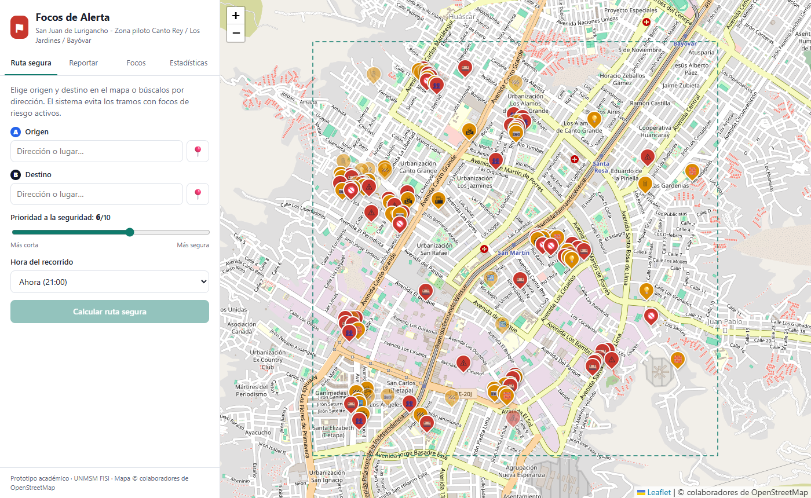
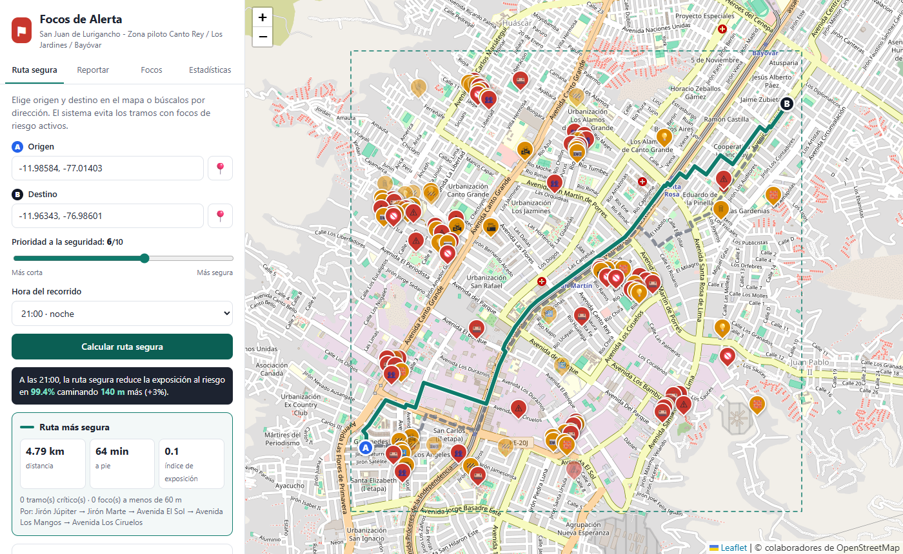
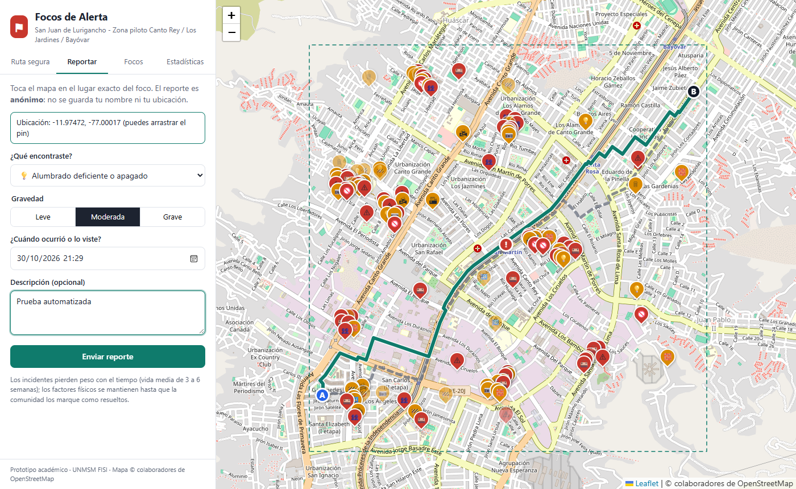
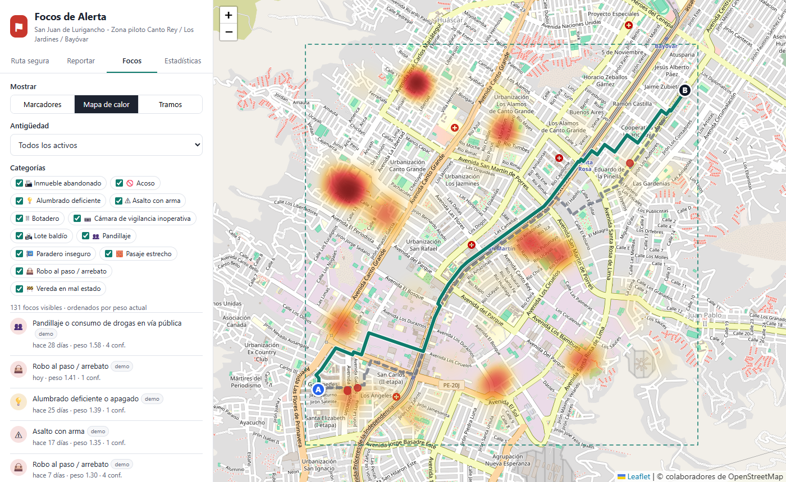
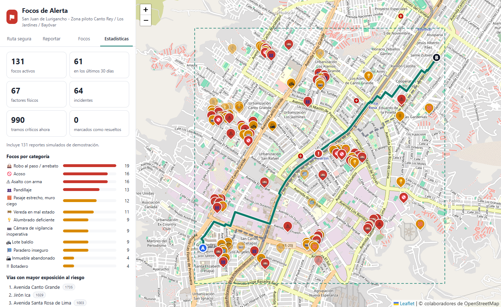

# Manual de usuario: Focos de Alerta

Guía para instalar, usar y **presentar** el sistema. No necesitas saber programar.

**Contenido**

1. [Antes de empezar](#1-antes-de-empezar)
2. [Abrir el sistema](#2-abrir-el-sistema)
3. [Conocer la pantalla](#3-conocer-la-pantalla)
4. [Calcular una ruta segura](#4-calcular-una-ruta-segura)
5. [Reportar un foco de riesgo](#5-reportar-un-foco-de-riesgo)
6. [Ver y validar los focos](#6-ver-y-validar-los-focos)
7. [Ver estadísticas y exportar datos](#7-ver-estadísticas-y-exportar-datos)
8. [Guion para la presentación](#8-guion-para-la-presentación)
9. [Preguntas que pueden hacer](#9-preguntas-que-pueden-hacer)
10. [Solución de problemas](#10-solución-de-problemas)

---

## 1. Antes de empezar

Necesitas:

- Una computadora con **Windows**, **macOS** o **Linux**.
- **Python 3.10 o superior.** Descárgalo de <https://www.python.org/downloads/>. En Windows, durante la instalación **marca la casilla “Add Python to PATH”**.
- **Internet**, para que cargue el mapa.

Para descargar el proyecto:

- **Con Git:** `git clone https://github.com/SoySergioSS/RutaSegura.git`
- **Sin Git:** en la página del repositorio en GitHub, pulsa **Code → Download ZIP** y descomprime el archivo.

---

## 2. Abrir el sistema

### En Windows

1. Entra a la carpeta del proyecto.
2. Haz doble clic en **`iniciar.bat`**.
3. La primera vez instalará lo necesario y cargará los datos de demostración (tarda menos de un minuto).
4. Se abrirá el navegador en **<http://localhost:5000>**.

> **No cierres la ventana negra** mientras uses el sistema: es el servidor. Para apagarlo, ciérrala.

### En macOS o Linux

Abre una terminal dentro de la carpeta del proyecto y escribe:

```bash
pip install -r requirements.txt
python herramientas/generar_datos_demo.py
python app.py
```

Luego abre <http://localhost:5000> en el navegador.

### Abrirlo en el celular (opcional, queda muy bien en la presentación)

1. Conecta la computadora y el celular a **la misma red wifi**.
2. En la computadora, abre una terminal y escribe `ipconfig` (en macOS o Linux, `ifconfig`). Anota la **dirección IPv4**, por ejemplo `192.168.1.25`.
3. En el navegador del celular escribe `http://192.168.1.25:5000`, con tu propia dirección.
4. Si Windows pregunta si quieres permitir el acceso a Python en el firewall, acepta para **redes privadas**.

---

## 3. Conocer la pantalla



- **A la izquierda**, el panel con cuatro pestañas: **Ruta segura**, **Reportar**, **Focos** y **Estadísticas**.
- **A la derecha**, el mapa de la zona piloto, marcada con un rectángulo punteado verde.
- **Los marcadores del mapa** indican el tipo de foco:
  - 🟠 **Naranja:** factor físico (alumbrado, lote baldío, cámara malograda…).
  - 🔴 **Rojo:** incidente (robo, asalto, acoso, pandillaje).
  - Los marcadores **más tenues** son focos antiguos o poco confirmados, que pesan poco en el cálculo.

En el celular, el mapa queda arriba y el panel abajo.

---

## 4. Calcular una ruta segura



1. Abre la pestaña **Ruta segura**.
2. **Elige el origen (A):** haz clic en el mapa, pulsa 📍 y luego un punto del mapa, o escribe una dirección y elígela de la lista.
3. **Elige el destino (B)** de la misma forma. Puedes arrastrar los pines A y B para moverlos.
4. Ajusta la **prioridad a la seguridad** (0 = la más corta, 10 = la más segura). El valor recomendado es 6.
5. Elige la **hora del recorrido**. De noche el alumbrado apagado pesa mucho más.
6. Pulsa **Calcular ruta segura**.

**Cómo leer el resultado:**

| En el mapa | Significa |
|---|---|
| Línea **verde continua** | Ruta más segura |
| Línea **gris punteada** | Ruta más corta (la que daría un navegador común) |
| Puntos **rojos** | Focos que la ruta corta atraviesa |

El panel muestra:

- Un **resumen**, por ejemplo: *“A las 21:00, la ruta segura reduce la exposición al riesgo en 99,3 % caminando 414 m más (+8,9 %)”*.
- La **distancia**, el **tiempo a pie** y el **índice de exposición** de cada ruta. Cuanto menor es el índice, menos riesgo.
- Los **focos que aún quedan cerca** de la ruta segura.

> **Dato:** si cambias la hora o la prioridad, la ruta se recalcula sola.

---

## 5. Reportar un foco de riesgo



1. Abre la pestaña **Reportar**.
2. **Haz clic en el mapa** en el lugar exacto del foco. Aparece un pin rojo con “!”, que puedes arrastrar.
3. Elige **qué encontraste**:
   - *Factores físicos:* alumbrado deficiente, lote baldío, cámara inoperativa, botadero, pasaje estrecho o muro ciego, inmueble abandonado, paradero inseguro, vereda en mal estado.
   - *Incidentes:* robo al paso, asalto con arma, acoso, pandillaje o consumo en la vía pública.
4. Elige la **gravedad**: leve, moderada o grave.
5. Indica **cuándo ocurrió**. Por defecto es el momento actual.
6. Escribe una **descripción** (opcional). **No escribas nombres ni datos de personas.**
7. Pulsa **Enviar reporte**.

El reporte aparece de inmediato en el mapa y ya cuenta para el cálculo de rutas.

> El reporte es **anónimo**: no se guarda tu nombre ni tu ubicación. Cada dispositivo puede enviar hasta 10 reportes por hora.

---

## 6. Ver y validar los focos



En la pestaña **Focos** puedes:

- Cambiar la vista entre **Marcadores**, **Mapa de calor** y **Tramos** (calles coloreadas: amarillo = riesgo medio, rojo = alto, granate = muy alto).
- Filtrar por **antigüedad** (últimos 7, 30 o 90 días) y por **categoría**.
- Ver la **lista de focos** ordenada por su peso actual. Al hacer clic en uno, el mapa se acerca a él.

**Validar un foco:** haz clic en un marcador y elige una opción.

- **👍 Sigue ahí:** confirma el reporte, que gana peso.
- **✔ Ya no existe:** con 3 votos de este tipo, el foco se retira del mapa.

No puedes confirmar tus propios reportes, y solo puedes votar una vez por foco.

---

## 7. Ver estadísticas y exportar datos



La pestaña **Estadísticas** muestra:

- Los focos activos, los de los últimos 30 días, cuántos son factores físicos y cuántos incidentes.
- Los **tramos críticos** en este momento y los focos marcados como resueltos.
- Un gráfico de **focos por categoría**.
- Las **vías con mayor exposición al riesgo**.

Los botones **Descargar CSV** (se abre en Excel) y **Descargar GeoJSON** (para programas de mapas como QGIS) sirven para preparar el informe a la municipalidad.

---

## 8. Guion para la presentación

Duración sugerida: **8 a 10 minutos**. Pueden repartirse los bloques entre los integrantes.

### Preparación (el día de la presentación)

- [ ] **Regenera los datos de demostración ese mismo día:** `python herramientas/generar_datos_demo.py`. Los incidentes pierden peso con el tiempo; si los datos son de hace semanas, el mapa se verá más vacío.
- [ ] Abre el sistema **antes** de que empiece la exposición y comprueba que carga el mapa.
- [ ] Prueba la ruta del bloque 3 para saber qué resultado sale.
- [ ] Si vas a usar el celular, comprueba la conexión (sección 2).
- [ ] Ten abiertas como respaldo las capturas de `docs/figuras/`, por si falla el internet.

### Bloque 1: El problema (1 min)

> “En Lima Metropolitana, el 62,9 % de las personas se siente inseguro al caminar de noche por su barrio (INEI, 2025). Los vecinos saben qué calle está a oscuras o dónde robaron ayer, pero esa información no está en ningún mapa. Las aplicaciones de navegación te dan la ruta más corta, no la más segura.”

### Bloque 2: Mostrar el mapa de riesgo (1,5 min)

1. Pestaña **Focos**, vista **Marcadores**: “Cada marcador es un reporte ciudadano; naranja es un factor físico y rojo un incidente.”
2. Haz clic en un marcador y muestra el detalle, el peso y los botones de validación.
3. Cambia a **Tramos**: “El sistema convierte los reportes en un nivel de riesgo para cada calle.”
4. Aclara: **“Estos datos son simulados para la demostración.”**

### Bloque 3: Calcular una ruta segura (2,5 min). Es el momento central

1. Pestaña **Ruta segura**. Hora: **21:00 · noche**. Prioridad: **6**.
2. **Origen:** esquina inferior izquierda de la zona piloto, cerca de *Santa Elizabeth / Los Jardines*.
3. **Destino:** esquina superior derecha, cerca de *Bayóvar*.
4. Pulsa **Calcular ruta segura**.
5. Explica: “La línea gris es lo que haría un navegador normal: pasa por varios focos. La verde rodea esos focos y solo agrega unos metros.” Lee en voz alta el resumen del porcentaje de reducción.
6. **Demuestra que el sistema considera la hora:** cambia a **11:00** y muestra que la ruta o el porcentaje cambian.
7. Mueve la **prioridad a 0** y muestra que ambas rutas coinciden: es la ruta más corta.

### Bloque 4: Reportar en vivo (1,5 min)

1. Pestaña **Reportar**. Haz clic **sobre la ruta verde** que acabas de calcular.
2. Categoría **Robo al paso / arrebato**, gravedad **Grave**, y envía.
3. Vuelve a **Ruta segura**: la ruta se recalcula sola y ahora evita ese punto.
4. Explica: “Un reporte nuevo cambia las rutas de inmediato.”

> Si lo haces desde el celular, el efecto es mayor: reportas en el celular y la ruta cambia en la pantalla del proyector.

### Bloque 5: Utilidad para la municipalidad (1 min)

1. Pestaña **Estadísticas**: muestra los indicadores y las vías más expuestas.
2. “Con **Descargar CSV**, la junta vecinal entrega a la municipalidad un inventario de postes apagados, lotes baldíos y cámaras malogradas para que se atiendan.”

### Bloque 6: Cómo funciona y cierre (1,5 min)

- Muestra el diagrama de arquitectura (`docs/figuras/arquitectura.png`).
- Explica la idea en una frase: “Cada calle tiene un costo igual a su longitud multiplicada por su riesgo, y el algoritmo A\* busca el camino de menor costo.”
- Menciona la evaluación: “En 300 rutas de prueba, 3 de cada 4 reducen el riesgo al menos 30 % sin alargar el recorrido más de 20 %.”
- Cierre: privacidad (anónimo, sin rastreo) y próximos pasos (piloto de 6 semanas con vecinos reales).

---

## 9. Preguntas que pueden hacer

**¿Los datos son reales?**
No. En la demostración son 131 reportes simulados, marcados con la etiqueta *demo*. La red de calles sí es real: viene de OpenStreetMap. En el piloto, los datos los ingresarán los vecinos.

**¿Qué pasa si alguien hace un reporte falso?**
Un reporte nuevo solo pesa 60 %. Gana peso si otros vecinos lo confirman, y se retira con 3 votos de “ya no existe”. Además, cada dispositivo puede enviar como máximo 10 reportes por hora.

**¿Un robo de hace meses sigue afectando la ruta?**
Cada vez menos. Un robo pierde la mitad de su peso cada 21 días y deja de contar después de unos 3 meses. Un factor físico, como un poste apagado, se mantiene hasta que los vecinos lo marquen como resuelto.

**¿Por qué importa la hora?**
Porque el riesgo cambia durante el día: un poste apagado casi no importa a mediodía, pero mucho de noche. Y los robos suelen repetirse en la misma franja horaria.

**¿El sistema reduce la delincuencia?**
No directamente. Reduce la **exposición** de las personas a lugares de riesgo y genera evidencia para que la municipalidad atienda los factores físicos.

**¿Guarda dónde estoy?**
No. No hay cuentas, no se guarda la ubicación del usuario ni el origen y destino de sus rutas. Cumple la Ley N.º 29733.

**¿Se puede usar en otro distrito?**
Sí. Con `herramientas/descargar_red_vial.py` se descarga la red de calles de cualquier zona.

**¿Por qué no usan Google Maps?**
Porque su servicio de rutas no permite asignar un costo propio a cada calle. Con OpenStreetMap tenemos el grafo completo y aplicamos nuestro propio algoritmo.

---

## 10. Solución de problemas

| Problema | Solución |
|---|---|
| `python` no se reconoce como comando | Reinstala Python y marca **Add Python to PATH**. En macOS o Linux, prueba con `python3`. |
| `No module named flask` | Ejecuta `pip install -r requirements.txt`. |
| El mapa sale en gris o vacío | Falta internet: el mapa base se descarga en línea. Revisa la conexión. |
| “No se pudo conectar con el servidor” | La ventana negra se cerró. Vuelve a abrir `iniciar.bat`. |
| “Address already in use” o el puerto 5000 está ocupado | Ya hay otra copia abierta. Ciérrala, o reinicia la computadora. |
| Hay pocos focos en el mapa | Los datos demo envejecieron. Ejecuta `python herramientas/generar_datos_demo.py`. |
| Quiero empezar de cero | Cierra el sistema, borra `data/focos.db` y vuelve a abrir `iniciar.bat`. |
| El celular no abre la página | Revisa que esté en la misma wifi, que uses la IP correcta y que el firewall permita Python. |
| La búsqueda de direcciones no encuentra nada | Solo busca dentro de la zona piloto. Elige el punto haciendo clic en el mapa. |
